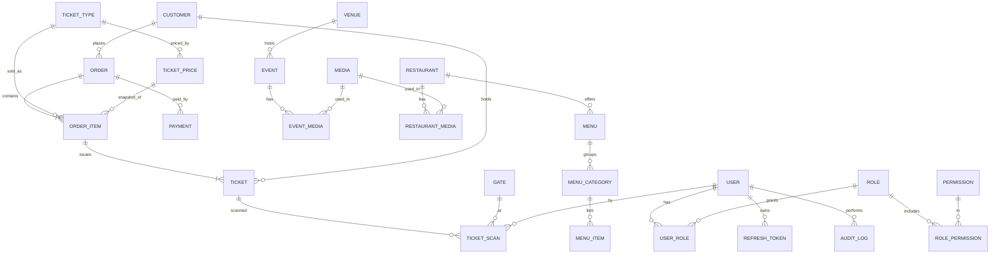

# Al-Azhar Park — Backend, Ticketing & Portal: Analysis and Proposal

Status: **proposal for approval — no backend code has been written.**
Date: 2026-10-04

---

## 1. Current project analysis

### 1.1 What exists
| Area | Finding |
|---|---|
| Stack | Vite 6 + React 18 + TypeScript 5.8, React Router 7, Tailwind 4, framer-motion, i18next / react-i18next. Single `package.json` at the repo root; npm lockfile. |
| Backend | **None.** No API, no `.env`, no Docker, no CI. |
| Tests / lint | **None** (no Vitest/Jest, no ESLint config). `npm run build` = `tsc -b && vite build`. |
| Version control | **Not a git repository.** |
| Hosting assumptions | Static SPA. `index.html`, `public/sitemap.xml`, `robots.txt` reference `https://www.azharpark.com`. |
| Repo clutter (root) | `Al-Azhar Park*.dc.html`, `al-azhar-park-standalone.html`, `support.js`, `uploads/`, `site-assets/`, `assets/`, `dist/`, two stray files named `--full-page` / `--selector`. Not part of the app; must be kept out of any deployment image. |
| Local tooling | Node 20.17, npm 10, pnpm 9, git 2.46. **Docker, PostgreSQL, Redis are not installed** on this machine. |

### 1.2 Frontend architecture (what the backend must fit)
- **Routes** (`src/App.tsx`): `/`, `/about`, `/plan`, `/restaurants`, `/restaurants/:slug`, `/events`, `/events/:slug`, `/news`, `/news/:slug`, `/gallery`, `/tickets` (`/visit` redirects), `/checkout`, `/contact`.
- **Content layer**: all public text is a typed object `SiteContent` (`src/content/types.ts`, 324 lines) with two instances, `en.ts` and `ar.ts` (~580 lines each), selected by `useContent()` / `useLanguage()` (23 call sites). Components receive the same shape in both languages. **This is the single best integration seam**: an API adapter that returns the same `SiteContent` slices lets components stay untouched.
- **i18n**: `en`/`ar`, language persisted in `localStorage`, `dir` switched on `<html>`.
- **Cart** (`src/lib/cart.tsx`): lines `{ ticketId, label, unitPrice, qty, visitDate }` persisted in `localStorage`. **The client sends its own `unitPrice`** — the backend must never trust it.
- **Ticket pricing** (`src/lib/tickets.ts`): hard-coded matrix of **audience (resident | visitor) × ticket type (adult | child) × day type (weekday | weekend)** = 8 prices. Weekend = Fri–Sat (`isWeekend`). The day type is derived from the chosen visit date.
- **Checkout** (`src/pages/Checkout.tsx`): collects name, email, phone, notes; **generates the order reference client-side** (`AZP-XXXXXX`), takes no payment and persists nothing. After "submit" it shows wallet and calendar buttons.
- **Other demo-only forms**: restaurant reservation (`ReservationForm`, reference `RES-…`), contact form (`Contact.tsx`), both unconnected.
- **Wallet** (`src/lib/wallet.ts`): already expects `VITE_WALLET_API_URL` with `/apple?ref=` and `/google?ref=` — a ready hook for later.
- **Calendar helpers** (`src/lib/calendar.ts`): build `.ics`/Google links; use Cairo DST-aware offsets.
- **Events**: `ComingSoonEvent` already has `title, description, body, image, date, time, startsAt, endsAt, location, status, featured` per language.
- **Restaurants**: `Restaurant` has `slug, name, brand, hours, tagline, body, atmosphere, image, gallery, phones[], menuUrl?` — menus are currently **external PDF links**.
- **Images**: resolved by file name through `import.meta.glob` (`src/lib/imageMap.ts`) — i.e. bundled at build time; CMS-uploaded images will need a URL-based path.
- **SEO**: client-side `useSeo` (document title + meta). SPA, no SSR.

### 1.3 Data already in the frontend that becomes backend-managed
Contact (address, phones, fax, email, maps URL), opening hours, ticket prices, events, restaurants (+ menus, hours, phones), park stats, visitor information/FAQs/rules, ticket groups, amenities.
**Stays static in code** (narrative content, not operational): About history/heritage text, timeline, journal articles, gallery captions, Plan-My-Day stops. They can move to the CMS later; they are not in scope for v1.

### 1.4 Constraints and conventions to respect
- Do not restructure or redesign the public site; keep its fallback behaviour working if the API is down (see §2.5).
- Reuse conventions: TypeScript strict, Tailwind 4 design tokens (teal/gold/sand), bilingual `En`/`Ar` fields.
- Existing open data conflicts that must be resolved before launch (see §7): ticket prices, park hours.

---

## 2. Proposed architecture

### 2.1 Repository layout (minimal disruption)
The public site **stays where it is**. New packages are siblings; the root `package.json` becomes an npm workspace root.

```
/                       ← existing public website (unchanged)
├─ backend/             ← NestJS API (TypeScript, Prisma)
│  ├─ prisma/           ← schema.prisma, migrations/, seed.ts
│  └─ src/modules/…
├─ portal/              ← internal web app (Vite + React + TS + Tailwind 4)
├─ packages/shared/     ← Zod schemas, enums, permission codes, types used by all three
├─ docs/                ← architecture.md, database.md, api.md, …
├─ docker/              ← Dockerfiles, compose (api, portal, postgres, redis, mailhog, pgadmin)
└─ .env.example
```
Why not move the site into `apps/web`: it is mechanical but touches every path, tsconfig, and the user's running dev server, for no functional gain. It can be done later as a separate, reviewable change.

### 2.2 Technology decisions
| Concern | Choice | Notes |
|---|---|---|
| API | NestJS (current LTS major), REST, `/api/v1` | Modular, DI, guards, interceptors |
| DB | PostgreSQL 16, Prisma ORM | Raw-SQL migrations where Prisma can't express a constraint (exclusion constraints, partial indexes, REVOKE) |
| Validation | **Zod everywhere** (via `nestjs-zod`), schemas in `packages/shared` | One source of truth for API, portal forms and public checkout. Avoids two validators |
| Auth | Argon2id, JWT access (15 min) + rotating refresh (7 d) | See §2.4 |
| Logging | Pino (`nestjs-pino`), request-id, redaction of secrets/PII | |
| Docs | `@nestjs/swagger` generated from Zod | `/api/docs` disabled in production unless enabled |
| Cache / rate-limit store | Redis (optional) | App must run without Redis (in-memory fallback) — Redis is for throttling, caching public reads, and later job queues (BullMQ) |
| Storage | `StorageProvider` interface + `LocalDiskProvider` | S3/R2/Cloudinary adapters later |
| Payments | `PaymentProvider` interface + `ManualPaymentProvider` | Paymob etc. later |
| Email | `MailProvider` interface; MailHog in dev | Required for tickets + password reset; production provider TBD |
| QR | `qrcode` (server-side PNG/SVG) | |
| PDF | Headless Chromium (HTML→PDF) | **Arabic needs proper shaping/RTL**; lightweight PDF libs render Arabic incorrectly. Isolated behind a `TicketRenderer` interface |
| Tests | Vitest/Jest + Supertest against a **real Postgres** | Concurrency tests cannot be faked with mocks |
| Portal | Vite, React 18, React Router, TanStack Query + Table, react-hook-form + Zod, Recharts, `@yudiel/react-qr-scanner` | Same stack as the public site |
| Lint/format | ESLint + Prettier (added; none exist today) | |

### 2.3 Backend module map (domains from the brief)
`auth` · `users` · `roles` (+ `permissions`) · `customers` · `park` (settings, contact, social) · `opening-hours` (weekly + special) · `ticket-types` (+ prices) · `orders` · `tickets` · `qr` · `scans` (+ gates) · `payments` · `events` (+ venues) · `restaurants` · `menus` · `media` · `analytics` · `audit-logs` · `notifications` · `settings` · `public` (read/write facade for the website) · `health`.
Cross-cutting: `common/` (envelope, errors, pagination, filters), `config/` (validated env), `security/` (guards, throttling, helmet, CORS).

Rules: modules talk through exported services, never through each other's Prisma models; every state-changing service call writes an audit entry; controllers hold no business logic.

### 2.4 Authentication & authorization
- **Login**: email + password → access JWT (15 min, in memory in the portal) + refresh token (opaque 256-bit, **hashed in DB**, httpOnly + Secure + SameSite=Strict cookie scoped to `/api/v1/auth`).
- **Rotation + reuse detection**: each refresh issues a new token in the same *family*; presenting an already-used token revokes the family.
- **Lockout / throttling**: per-IP and per-account throttle, incremental delay after N failures; all events audited.
- **Password reset**: single-use hashed token, 30-minute expiry, always-200 response (no account enumeration).
- **Deactivation** immediately invalidates refresh tokens; access tokens are short-lived and checked against `user.isActive` + `tokenVersion`.
- **RBAC**: users → roles → **permissions** (`resource:action`, e.g. `tickets:read`, `tickets:cancel`, `scans:create`, `pricing:write`, `events:publish`). Guards check **permissions**, never role names; roles are data, so new roles need no code change. `SUPER_ADMIN` has `*`.
- **Customers have no passwords in v1.** They reach their order/tickets through an emailed **magic link** (signed, expiring access token) — matches the current guest checkout and avoids a second auth system. Accounts can be added later without schema changes (`Customer.userId` nullable is *not* needed now).

#### Initial permission matrix (seeded, editable)
| Permission group | SUPER_ADMIN | ADMIN | OPERATIONS | TICKET_STAFF | CONTENT_MANAGER | ANALYST |
|---|:-:|:-:|:-:|:-:|:-:|:-:|
| users / roles (manage) | ✓ | users only | – | – | – | – |
| system settings / audit (read) | ✓ | audit | – | – | – | – |
| content: park, hours, contact | ✓ | ✓ | hours/contact | – | ✓ | – |
| events / restaurants / menus / media | ✓ | ✓ | events (operational) | – | ✓ | – |
| ticket types & **pricing** | ✓ | ✓ | – | – | – | read |
| orders / tickets (read) | ✓ | ✓ | ✓ | limited (entry fields) | – | ✓ |
| ticket cancel / refund | ✓ | ✓ | ✓ | – | – | – |
| scan (create) / scan history | ✓ | ✓ | ✓ | ✓ (own + gate) | – | read |
| analytics | ✓ | ✓ | operational | – | content stats | ✓ |

### 2.5 Frontend integration strategy (no redesign)
1. **`src/lib/api.ts`** — a typed client (base URL from `VITE_API_URL`, `Accept-Language`, abort/timeouts).
2. **Content adapters** map API responses to the existing `SiteContent` slices (`contact`, `visitorBar.hours`, `restaurants.list`, `comingSoon.events`, `visit.ticketGroups`, …). `useContent()` merges *API data over the static baseline*, so **if the API is down, the site still renders from the bundled content** (graceful degradation; no blank pages).
3. **Tickets**: `ticketCatalog` (`lib/tickets.ts`) is replaced by `GET /public/ticket-types?visitDate=` (server resolves the weekday/weekend price). The cart keeps `ticketTypeCode`, audience, qty, date — **not** price. Prices shown are previews; the server recomputes at order time and returns the authoritative totals.
4. **Checkout**: `POST /public/orders` (with `Idempotency-Key`) replaces client-side reference generation; the confirmation page shows the *server* order number, QR ticket(s), PDF download, wallet buttons (existing `VITE_WALLET_API_URL` contract).
5. **Contact form / restaurant reservation** become real endpoints (`ContactMessage`, `ReservationRequest` — **not in your list; required to make existing forms functional**).
6. **Images**: CMS content stores URLs; `resolveImage` already falls back to the raw path, so absolute URLs work.
7. Rollout per domain behind a `VITE_USE_API` flag so each slice can be verified in isolation.

---

## 3. Database design (PostgreSQL)

Conventions: UUID v7 primary keys (`uuid`), `created_at`/`updated_at` (`timestamptz`), soft delete (`deleted_at`) on content entities only, **never** on orders/tickets/payments/scans/audit. Money as **integer minor units (piastres)** + `currency` (`EGP`). Bilingual fields `name_en` / `name_ar`. All "visit dates" are `date` in **Africa/Cairo**.

### 3.1 ERD (Mermaid)


### 3.2 Tables (key columns, constraints, indexes)

**Identity & access**
- `users` — `id`, `email` (**unique**, citext), `password_hash`, `full_name`, `is_active`, `token_version`, `last_login_at`, `failed_logins`, `locked_until`.
- `roles` — `id`, `code` (unique), `name`, `is_system`.  `permissions` — `id`, `code` (unique, `resource:action`), `description`.
- `role_permissions` (PK role+permission), `user_roles` (PK user+role).
- `refresh_tokens` — `id`, `user_id`, `family_id`, `token_hash` (unique), `expires_at`, `revoked_at`, `replaced_by`, `ip`, `user_agent`.
- `password_reset_tokens` — hashed token, `expires_at`, `used_at`.

**Customers, orders, payments**
- `customers` — `id`, `full_name`, `email` (index, citext), `phone`, `country`, `audience` (`RESIDENT|VISITOR`, only if provided), `created_at`. Minimal data only.
- `orders` — `id`, `order_number` (**unique**, e.g. `AZP-261004-K7QX2`), `customer_id`, `visit_date`, `status` (`PENDING|CONFIRMED|CANCELLED|EXPIRED|REFUNDED`), `subtotal_minor`, `total_minor`, `currency`, `access_token_hash`, `idempotency_key` (unique per customer), `source` (`WEB|COUNTER|PORTAL`), `notes`, `created_at`.
- `order_items` — `id`, `order_id`, `ticket_type_id`, `ticket_price_id`, **snapshot columns**: `type_name_en/ar`, `audience`, `day_type`, **`unit_price_minor`**, `currency`, `quantity`, `line_total_minor`.
- `payments` — `id`, `order_id`, `provider`, `provider_txn_id` (unique per provider), `amount_minor`, `currency`, `status` (`PENDING|PAID|FAILED|REFUNDED|CANCELLED`), `paid_at`, `metadata jsonb`.

**Ticketing**
- `ticket_types` — `id`, `code` (unique: `ADULT`, `CHILD`), `name_en/ar`, `description_en/ar`, `min_age`, `max_age`, `is_active`, `sort_order`, `deleted_at`.
- `ticket_prices` — `id`, `ticket_type_id`, `audience` (`RESIDENT|VISITOR`), `day_type` (`WEEKDAY|WEEKEND`), `amount_minor`, `currency`, `valid_from` (date), `valid_to` (date, nullable), `created_by`. **Exclusion constraint** (`btree_gist`) so ranges for the same (type, audience, day_type) cannot overlap. Prices are **append-only**: a change = close the old row, insert a new one.
- `tickets` — `id`, `public_ref` (**unique**, short human reference `AZP-T-…`), `order_item_id`, `order_id`, `customer_id`, `ticket_type_id`, `visit_date`, **`price_paid_minor`**, `currency`, `holder_name` (optional), `status` (`PENDING|PAID|VALID|USED|CANCELLED|EXPIRED|REFUNDED`), `qr_token_hash` (**unique**), `used_at`, `used_by`, `cancelled_at`, `cancel_reason`.
  Indexes: `qr_token_hash`, `(visit_date, status)`, `order_id`, `customer_id`.
- `gates` — `id`, `code` (unique), `name`, `is_active`.
- `ticket_scans` — `id`, `ticket_id` (**nullable** — invalid tokens have no ticket), `token_fingerprint`, `scanned_by`, `gate_id`, `result` (`VALID|INVALID`), `reason` (`OK|NOT_FOUND|ALREADY_USED|CANCELLED|REFUNDED|EXPIRED|WRONG_DATE|NOT_PAID|INVALID_TOKEN`), `scanned_at`, `device jsonb`, `ip`.  Indexes: `scanned_at`, `(ticket_id)`, `(scanned_by, scanned_at)`, `(gate_id, scanned_at)`.

**Content**
- `park_settings` (single row: names, descriptions, stats jsonb, visitor-info blocks), `contact_information` (single row + `social_links jsonb`), `opening_hours` (weekday, `opens`, `closes`, `is_closed`), `special_hours` (date or range, `opens/closes`, `is_closed`, `note_en/ar`).
- `venues` (`name_en/ar`, description, lat/lng), `events` (`slug` unique, titles/descriptions en+ar, `starts_at`, `ends_at`, `status` `DRAFT|PUBLISHED|CANCELLED|COMPLETED`, `is_featured`, `sort_order`, `venue_id`, `deleted_at`; index `(status, starts_at)`), `event_media`.
- `restaurants` (`slug` unique, names/descriptions/tagline en+ar, `brand`, opens/closes, `phones text[]`, `reservation_url`, `website_url`, `instagram_url`, `is_active`, `sort_order`, `deleted_at`), `restaurant_media`.
- `menus` (restaurant, names en+ar, `pdf_media_id?`, `is_active`), `menu_categories`, `menu_items` (names/descriptions en+ar, `price_minor`, `currency`, `media_id`, `is_available`, `sort_order`).
- `media` — `id`, `storage_key`, `url`, `file_name`, `mime_type`, `size_bytes`, `width`, `height`, `uploaded_by`, `created_at` (no binary data in the DB).

**Operations**
- `contact_messages`, `reservation_requests` (needed by the existing forms), `notifications` (outbox: channel, template, recipient, payload, status, attempts), `audit_logs` — `id`, `user_id`, `action`, `entity`, `entity_id`, `old_value jsonb`, `new_value jsonb`, `ip`, `user_agent`, `created_at` (**append-only**: the app DB role has no UPDATE/DELETE on it). Indexes: `created_at`, `(entity, entity_id)`, `user_id`.

### 3.3 Business-rule enforcement in the schema
| Rule | Mechanism |
|---|---|
| Old orders never change when prices change | `order_items.unit_price_minor` + snapshot columns and `tickets.price_paid_minor` are written once; `ticket_prices` rows are append-only |
| A ticket is used once | `UPDATE tickets SET status='USED' … WHERE id=$1 AND status='VALID' AND visit_date = (now() AT TIME ZONE 'Africa/Cairo')::date` — success = 1 row affected; the scan row is written in the same transaction |
| Unique QR | unique index on `qr_token_hash` |
| Never delete financial history | no soft/hard delete path on orders, tickets, payments, scans; FKs `ON DELETE RESTRICT` |
| Non-overlapping prices | exclusion constraint |
| Audit immutability | DB role privileges |

---

## 4. API architecture

Base: `/api/v1`. Two surfaces:

- **Public** (`/api/v1/public/*`, unauthenticated, rate-limited, cacheable): `site` (contact + hours + park info), `opening-hours`, `events`, `events/:slug`, `restaurants`, `restaurants/:slug`, `restaurants/:slug/menus`, `ticket-types?visitDate=`, `orders` (POST, `Idempotency-Key`), `orders/:orderNumber?token=`, `tickets/:ref?token=`, `tickets/:ref/pdf?token=`, `contact-messages` (POST), `reservation-requests` (POST).
- **Portal** (`/api/v1/<resource>`, JWT + permission guard): `auth` (login, refresh, logout, me, change-password, forgot/reset), `users`, `roles`, `permissions`, `park`, `opening-hours`, `contact`, `ticket-types` (+ `/:id/prices`), `orders`, `customers`, `tickets` (read, cancel, refund, resend), `payments`, `scans` (POST `/scans/validate`, GET history), `events`, `restaurants`, `menus`, `media` (upload), `analytics/*`, `audit-logs`, `notifications`, `settings`, `health`.

Conventions
- **Envelope**: success `{ data, meta? }`; error `{ error: { code, message, details?, requestId } }` (stable machine-readable `code`).
- **Lists**: `?page&limit&search&sortBy&sortOrder` plus resource filters; `meta: { page, limit, total, totalPages }`; limit capped at 100.
- **Versioning** in the path; OpenAPI from Zod; correlation `X-Request-Id`.
- **Idempotency** on order creation and scan submission (client-supplied key) so retries cannot double-create.
- **Security**: Helmet, strict CORS allow-list (public site + portal origins), global validation pipe (Zod, whitelisting), throttling (stricter on login, public orders, scans), `trust proxy` configured for real client IPs, file-upload validation (MIME sniffing, size, dimensions), no stack traces/secrets in responses.

### 4.1 Order → ticket flow
1. Client submits `{ visitDate, items:[{ ticketTypeCode, audience, quantity }], customer }`.
2. Server (one transaction): validate date (not past, within booking window, park open that day), resolve each price from `ticket_prices` for the visit date's day type, snapshot into `order_items`, create `orders` + `payments(PENDING)`.
3. Payment confirmed (manual in v1 / provider webhook later) → in one transaction: payment `PAID`, order `CONFIRMED`, create one `tickets` row **per person** with a random 128-bit QR token (**only its hash is stored**; the token is shown/emailed once and re-derivable through the access-token-protected ticket view), status `PAID → VALID`.
4. Notification outbox queues the email with the PDF.

### 4.2 QR token & scan validation
- QR payload: `AZP1:<base64url token>` — **no customer data**, no URL (so a phone camera won't open a link that exposes it).
- Scan: `POST /scans/validate { token, gateCode }` (`scans:create`):
  1. Hash token → find ticket; none → record `INVALID/INVALID_TOKEN` or `NOT_FOUND`.
  2. Reject by status/date: `CANCELLED`, `REFUNDED`, `EXPIRED`, `PENDING`, `WRONG_DATE`.
  3. **Atomic claim**: `UPDATE … WHERE status='VALID' …` (see §3.3). 0 rows → re-read and return `ALREADY_USED` (with who/when).
  4. Insert the `ticket_scans` row in the same transaction; response shows name, type, visit date, ticket ref (order id only for roles allowed).
- Concurrency test: N parallel connections scanning the same token ⇒ **exactly one** success.

---

## 5. Portal architecture

- **Separate app** `portal/` (Vite + React + TS + Tailwind 4), deployed on its own origin (e.g. `portal.azharpark.com`). Public site never ships portal code.
- **Auth**: access token in memory, refresh via cookie; route guards from `/auth/me` permissions (UI hides what the user can't do — the server still enforces).
- **Navigation** (permission-driven): Dashboard · Tickets · Orders · Customers · **Ticket Scanner** · Events · Restaurants · Menus · Park Information · Opening Hours · Contact Information · Analytics · Users · Roles & Permissions · Audit Logs · Settings.
- **Scanner** (mobile/tablet-first PWA route): full-screen camera, torch toggle, large VALID/INVALID result card (colour + icon + sound/vibration), gate selector remembered per device, manual code entry fallback, offline notice (v1 requires connectivity).
- **Shared UI kit**: data table (server-side pagination/sort/filter/search), form kit (react-hook-form + shared Zod), confirm dialogs for destructive actions, image uploader, empty/loading/error states, toasts, RTL-capable inputs for Arabic fields.
- **Analytics**: Recharts — line (revenue/sales/visitors trend), stacked/clustered bar (by ticket type, by gate/staff), donut (ticket-type mix, used vs unused), heatmap/bar (peak entry hour). Global filter bar (date presets, ticket type, status, audience, gate, staff, event).
- **Design**: reuses the brand tokens (teal/gold) but a calmer operational layout; responsive down to tablet; scanner usable one-handed on a phone.

### 5.1 Analytics computation
SQL aggregations over indexed tables (`orders`/`order_items` for revenue — **paid only**, `tickets` for sales/visit/used, `ticket_scans` for entry). Short Redis cache (e.g. 60 s) for dashboard cards. Materialised views only if volume demands it. All dates bucketed in `Africa/Cairo`.

---

## 6. Implementation phases (each ends with: lint · typecheck · tests · build green)

**Phase 0 — Prerequisites (before any code)**: initialise git + baseline commit of the current site; `.gitignore` for secrets/uploads/dist; confirm a Postgres runtime (§7); add ESLint/Prettier/Vitest scaffolding; npm workspaces; `docker/compose` skeleton.
1. **Foundation** — NestJS, config validation, Prisma + first migration, Pino, error envelope, Swagger, health checks, Docker, CI script.
2. **Auth + RBAC** — users/roles/permissions, login/refresh/logout, reset, throttling, guards; seed roles. *Gate: permission-guard tests; refresh-reuse test.*
3. **Park CMS** — contact, opening hours (+ special), park info; public read API; **frontend slice 1** (contact, hours, footer).
4. **Restaurants + menus** + media upload abstraction; **frontend slice 2**.
5. **Events** (+ venues, draft/publish/reorder/preview); **frontend slice 3** (Coming Soon, `/events/:slug`).
6. **Ticket types + pricing** (effective dates, history, overlap constraint); **frontend slice 4** (`/tickets` builder reads server prices).
7. **Orders + ticket generation + payments (manual provider)**, customers, magic-link access, PDF (Arabic-correct), email outbox; **frontend slice 5** (real checkout + confirmation + wallet hook).
8. **QR + scanning + anti-double-scan**, gates, scan history. *Gate: concurrency test on real Postgres.*
9. **Portal shell + dashboard + CRUD screens + Scanner UI**.
10. **Analytics** endpoints + charts + filters.
11. **Audit log UI/search + security hardening** (headers, CORS, rate limits, upload validation, secrets, dependency audit).
12. **Testing completion, documentation (`docs/*.md`, `.env.example`), production readiness** (Docker images, migrations on deploy, backups, monitoring hooks).

Per-phase deliverable: working code + tests + short changelog; I stop at each gate and report results before continuing.

---

## 7. Risks, conflicts and missing requirements

### Blocking / need your decision
1. **No Postgres/Docker on this machine.** I can't run migrations, seeds or the critical double-scan concurrency tests without a real PostgreSQL. Options: (a) install **Docker Desktop** (recommended; compose included), (b) install PostgreSQL 16 locally (+ pgAdmin), (c) use the `embedded-postgres` npm package for local/test runs only.
2. **Ticket prices conflict.** Site/official image: Egyptians & residents 50/60 (adult, Sun–Thu / Fri–Sat) and 35/40 (child); visitors 150/200 and 100/150. A WhatsApp text gave 35/23 and 40/30. The seed will use the image's prices — **please confirm.**
3. **Payment at launch.** "Cash on delivery" doesn't map to e-tickets. Proposed: v1 supports (i) *manual confirmation* (staff marks an order PAID) and (ii) a **counter-sale** screen where staff sell a ticket at the booth, take cash, and print/scan immediately. Online payment (Paymob) plugs in later via `PaymentProvider`. Confirm this is what you want.
4. **Park hours conflict.** Site previously said 10:00–17:00; official image and chat say **9:00–22:00** (already updated on the site). Seed uses 9–22 — confirm, and whether Fri/holidays differ.

### Needs a defined rule (I will propose defaults unless you say otherwise)
5. **Ticket status semantics.** `PAID` and `VALID` overlap. Default: `PENDING` (awaiting payment) → `VALID` (paid, scannable); `PAID` is set transiently in the same transaction as issuance; `EXPIRED` assigned when the visit date has passed without use.
6. **Booking rules**: how far ahead can people book; same-day booking until what time; per-day **capacity limit** (not in the brief); free entry for children under 2 (the site says child = 2–8); refunds/cancellation window; rescheduling (default: not supported in v1).
7. **Customer access**: magic-link only (no passwords) — default.
8. **Email provider** (tickets + password reset) and **sender domain** are unknown (Resend / SES / SMTP?).
9. **Hosting target** (VPS, Azure, AWS, local Egyptian hosting) and **domain** for the API and portal (CORS, cookies, sitemap, canonical URLs).
10. **Personal-data compliance**: Egypt's Personal Data Protection Law (No. 151 of 2020) applies to customer data → retention policy, privacy notice and consent text needed before launch.

### Technical risks
- **Arabic PDF/QR ticket rendering** needs Chromium (heavier image); mitigated by isolating the renderer.
- **Image URLs**: the public site resolves images by bundled file name today; CMS uploads need a stable public URL/CDN and cache headers.
- **SPA SEO**: dynamic content is fetched client-side; crawlers and social previews will not see it unless prerendering/SSR is added later (the site already uses client-side meta).
- **Scanner reliability**: camera/BarcodeDetector support varies on old Android devices; manual-entry fallback and a field test are planned. Offline scanning is out of scope for v1.
- **Scope**: the brief covers ~20 domains; the phase plan keeps each shippable and testable, but the portal UI (Phase 9–10) is the largest effort.

### Out of scope for v1 (can be added later)
Online card payments, customer accounts/passwords, wallet pass issuance (hook exists), offline scanning, CMS for About/journal/gallery narrative content, push notifications.

---

## 8. What I need to proceed
Answers to **1–4** (the rest I'll default as written). Then I start with **Phase 0 → Phase 1** and report results at the first gate.
